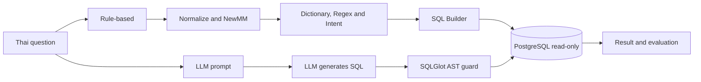

# Thai Text-to-SQL Comparison

A comparative study of rule-based and large language model approaches for Thai Text-to-SQL using synthetic sales and inventory data.

โครงการนี้ศึกษาการแปลงคำถามภาษาไทยเป็นคำสั่ง SQL โดยเปรียบเทียบสองแนวทางภายใต้คำถาม Schema ฐานข้อมูล และ SQL อ้างอิงชุดเดียวกัน:

- **Rule-based:** ทำความสะอาดข้อความ ตัดคำด้วย PyThaiNLP/NewMM จับ Intent ด้วยพจนานุกรมและ Regular Expression แล้วประกอบ SQL ด้วย SQL Builder
- **LLM:** ส่งคำถาม Schema และนิยามธุรกิจให้โมเดลสร้าง SQL จากนั้นตรวจ AST และข้อจำกัดก่อนรัน

โครงการเป็น **Domain-specific prototype** สำหรับข้อมูลสังเคราะห์ด้านการขายและคลังสินค้า ไม่ใช่ WMS เต็มระบบ และยังไม่ใช้แทนผลจากระบบขององค์กรจริง

## Research question

ภายใต้โดเมนการขายและคลังสินค้า แนวทาง Rule-based และ LLM แตกต่างกันอย่างไรในด้าน Execution Accuracy ความสามารถในการรองรับภาษาไทยที่หลากหลาย เวลา Token ความสม่ำเสมอ และประเภทข้อผิดพลาด

## Scope

ระบบรองรับคำถามหลัก 5 รูปแบบ:

1. ยอดขายรวมรายเดือน
2. ยอดขายรายเดือนแยกตามสินค้า
3. Top-N สินค้าตามยอดขายเป็นเงิน
4. สินค้าคงเหลือแยกตามสินค้าและคลัง
5. จำนวนสินค้าจ่ายออกรายเดือน แยกตามสินค้าและรวมทุกคลัง

ข้อกำหนดหลัก:

- สร้างเฉพาะคำสั่ง `SELECT`
- รับคำถามครั้งละหนึ่งคำถาม
- คำถามรายเดือนต้องระบุชื่อเดือนและปีสี่หลัก
- ใช้ข้อมูลสังเคราะห์และ Schema 5 ตาราง
- คำถามนอกขอบเขตต้องถูกปฏิเสธโดยไม่ละทิ้งเงื่อนไขของผู้ใช้

สิ่งที่ยังไม่รองรับ ได้แก่ การสนทนาหลายรอบ การโอนคลัง การจองและคืนสินค้า Lot, Serial, วันหมดอายุ สต็อกย้อนหลัง การเปรียบเทียบหลายช่วงเวลา และตัวกรองชื่อสินค้า/คลังเฉพาะรายการ

## Data model

| Table | Purpose |
|---|---|
| `products` | สินค้าและราคาปัจจุบัน |
| `orders` | วันที่และสถานะคำสั่งซื้อ |
| `order_items` | จำนวนและราคาขณะขายของแต่ละรายการ |
| `warehouses` | คลังสินค้า |
| `stock_movements` | ยอดตั้งต้น รับเข้า และจ่ายออก |

นิยามธุรกิจสำคัญ:

```text
ยอดขาย = SUM(order_items.qty × order_items.unit_price)
          เฉพาะ orders.status = paid

คงเหลือ = opening + receipt - issue
          แยกสินค้าและคลัง จากทุก movement ที่บันทึก

ยอดจ่ายออก = SUM(stock_movements.qty)
             เฉพาะ movement_type = issue ตาม movement_date
```

## Architecture



ฝั่ง LLM ใช้ SQLGlot ตรวจว่าเป็น `SELECT` เพียงคำสั่งเดียว ใช้เฉพาะตาราง คอลัมน์ และฟังก์ชันที่อนุญาต ก่อนให้ PostgreSQL ตรวจด้วย `EXPLAIN` และรันใน Read-only transaction พร้อม timeout และ row limit

## Evaluation

ตัวชี้วัดหลักคือ **Execution Accuracy** โดยรัน SQL ของระบบและ SQL อ้างอิงกับ Database snapshot เดียวกัน แล้วเปรียบเทียบผลครบทุกแถวและทุกคอลัมน์ รวมแถวซ้ำ และตรวจลำดับสำหรับ Top-N

ตัวชี้วัดประกอบ:

- Valid SQL / Execution success rate
- ความถูกต้องในการปฏิเสธคำถามนอกขอบเขต
- Median และ p95 latency
- Input/output tokens และต้นทุนเมื่อมีอัตราค่าบริการ
- Consistency จากการรัน LLM ซ้ำ
- Error analysis แยกตามประเภทข้อผิดพลาด

ผลทดลองเดิม 10 ข้อเป็นเพียง **preliminary synthetic evaluation** ไม่ใช่ Benchmark มาตรฐานหรือผลสรุปของโครงการ ดูรายละเอียดที่ [`Seminar-Project-v1/SPRINT2.md`](Seminar-Project-v1/SPRINT2.md)

## Project status

โครงการอยู่ใน **Sprint 1: Scope, Schema, and Ground Truth** โดยกำลังตรึงขอบเขต ตรวจ Schema นิยามธุรกิจ Reference SQL และออกแบบ Development/Test protocol

- Sprint plan: [`Seminar-Project-v1/SPRINT1_PROJECT.md`](Seminar-Project-v1/SPRINT1_PROJECT.md)
- Data dictionary: [`Seminar-Project-v1/DATA_DICTIONARY.md`](Seminar-Project-v1/DATA_DICTIONARY.md)
- Business rules: [`Seminar-Project-v1/BUSINESS_RULES.md`](Seminar-Project-v1/BUSINESS_RULES.md)
- Schema guide: [`Seminar-Project-v1/SCHEMA_GUIDE.md`](Seminar-Project-v1/SCHEMA_GUIDE.md)
- Presentation runbook: [`Seminar-Project-v1/PRESENTATION_RUNBOOK.md`](Seminar-Project-v1/PRESENTATION_RUNBOOK.md)

## Quick start on Windows

Prerequisites:

- Python 3.12+
- PostgreSQL installed locally
- IntelSphere API key สำหรับโหมด LLM แบบรันสด

```powershell
cd Seminar-Project-v1

py -3.12 -m venv .venv
.\.venv\Scripts\python.exe -m pip install -r requirements-lock.txt

Copy-Item .env.llm.example .env.llm
notepad .env.llm

powershell -ExecutionPolicy Bypass -File .\start-demo.ps1
```

เปิดหน้า Demo ที่ <http://127.0.0.1:8000/> และเปิด API documentation ที่ <http://127.0.0.1:8000/docs>

หยุดระบบด้วย `Ctrl+C` แล้วหยุดฐานข้อมูล Demo:

```powershell
.\.venv\Scripts\python.exe -m scripts.local_demo stop
```

ไฟล์ Offline demo อยู่ที่:

```text
Seminar-Project-v1/output/presentation/offline-demo.html
```

## Tests

```powershell
cd Seminar-Project-v1
.\.venv\Scripts\python.exe -m pytest -q
```

## Repository structure

```text
Seminar-Project-v1/
├── app/
│   ├── nlp/              Rule-based normalization and intent parsing
│   ├── sql/              Intent-to-SQL builders
│   └── llm/              Prompt, model client, SQL guard and execution
├── config/               Lexicon and business definitions
├── db/                   Schema, synthetic data and reference SQL
├── eval/                 Development/test sets and evaluation runner
├── tests/                Automated tests
├── web/                  Demo user interface
├── output/               Recorded preliminary results and offline demo
└── scripts/              Local database and utility scripts
```

## Configuration and secrets

คัดลอก `.env.llm.example` เป็น `.env.llm` แล้วใส่ API key ในเครื่องเท่านั้น ไฟล์ `.env.llm`, `.env`, `.local`, `.venv`, Log และ ZIP ถูกกันออกจาก Git ด้วย `.gitignore`

ห้าม Commit API key, รหัสผ่านฐานข้อมูล หรือข้อมูลลูกค้าจริงขึ้น Repository

## Current limitations

- Schema ข้อมูล คำถาม และ Ground Truth ปัจจุบันมี AI ช่วยสร้าง
- ยังไม่มีการตรวจสอบกับ WMS ขององค์กรจริง
- Preliminary test มีเพียง 10 คำถามและ Database snapshot เดียว
- LLM อาจให้ผลต่างกันเมื่อรันซ้ำ
- ยังไม่มีอัตราค่าบริการ IntelSphere สำหรับคำนวณต้นทุนเป็นเงินบาท
- การผ่าน SQL Guard ยืนยันว่าคำสั่งอยู่ในขอบเขตและรันได้ ไม่ได้ยืนยันว่าความหมายถูกต้อง

## License

No license has been selected. All rights are reserved until the project owners choose a license.
