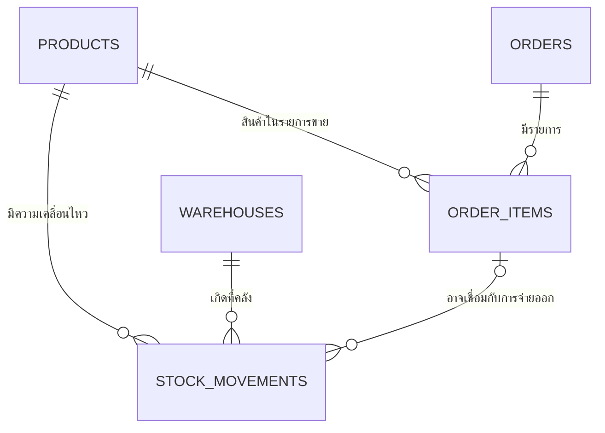

# Data Dictionary — Synthetic Sales and Inventory Demo

**Version:** 0.1-draft

**Updated:** 2026-11-12

**Canonical schema:** `db/demo_schema.sql`

เอกสารนี้อธิบายโครงสร้างข้อมูลที่ใช้ในต้นแบบ Thai Text-to-SQL เท่านั้น Schema และข้อมูลทั้งหมดเป็นข้อมูลสังเคราะห์สำหรับการทดลอง ไม่ได้คัดลอกหรือยืนยันว่าเหมือนกับ WMS ขององค์กรจริง

## ขอบเขตของ Schema

Schema ประกอบด้วย 5 ตาราง แบ่งเป็น 2 ส่วน:

- การขาย: `products`, `orders`, `order_items`
- คลังสินค้า: `warehouses`, `stock_movements`

> เส้นความสัมพันธ์แสดงสิ่งที่ Schema อนุญาต ไม่ได้หมายความว่าข้อมูล Seed ครบทุกกรณีที่เป็นไปได้

## Grain ของแต่ละตาราง

| ตาราง | หนึ่งแถวแทนอะไร | ใช้ตอบคำถามหลัก |
|---|---|---|
| `products` | สินค้าหนึ่งชนิด | ชื่อสินค้าและราคาปัจจุบัน |
| `orders` | คำสั่งซื้อหนึ่งรายการ | วันที่ขายและสถานะคำสั่งซื้อ |
| `order_items` | สินค้าหนึ่งรายการย่อยในคำสั่งซื้อ | จำนวนและราคาขณะขาย |
| `warehouses` | คลังสินค้าหนึ่งแห่ง | ชื่อคลัง |
| `stock_movements` | เหตุการณ์เปลี่ยนสต็อกหนึ่งครั้ง | ยอดคงเหลือและยอดจ่ายออก |

## `products`

ข้อมูลหลักของสินค้า

| คอลัมน์ | ชนิด | Null | Key / Constraint | ความหมาย | ตัวอย่าง |
|---|---|---:|---|---|---|
| `id` | `INTEGER` | ไม่ได้ | PK, Identity | รหัสสินค้า | `1` |
| `name` | `TEXT` | ไม่ได้ | UNIQUE | ชื่อสินค้า | `ปากกา` |
| `price` | `NUMERIC(12,2)` | ไม่ได้ | `price >= 0` | ราคาปัจจุบันในแค็ตตาล็อก ไม่ใช่ราคาขายย้อนหลัง | `18.00` |

ข้อควรระวัง: ห้ามใช้ `products.price` คำนวณยอดขายย้อนหลัง เพราะราคาอาจเปลี่ยนหลังการขายแล้ว

## `orders`

ส่วนหัวของคำสั่งซื้อ

| คอลัมน์ | ชนิด | Null | Key / Constraint | ความหมาย | ตัวอย่าง |
|---|---|---:|---|---|---|
| `id` | `INTEGER` | ไม่ได้ | PK, Identity | รหัสคำสั่งซื้อ | `1` |
| `order_date` | `DATE` | ไม่ได้ | — | วันที่ของการขาย ใช้เป็นฐานเวลาของคำถามยอดขาย | `2026-09-01` |
| `status` | `TEXT` | ไม่ได้ | `paid`, `pending`, `cancelled` เท่านั้น | สถานะคำสั่งซื้อ; นิยามยอดขายนับเฉพาะ `paid` | `paid` |

Schema ไม่มีเวลาเก็บเงินจริงหรือตาราง Payment ดังนั้น `paid` ในงานนี้เป็นสถานะของคำสั่งซื้อ ไม่ใช่หลักฐานการรับชำระเงินจริงในระบบบัญชี

## `order_items`

รายการสินค้าย่อยของแต่ละคำสั่งซื้อ

| คอลัมน์ | ชนิด | Null | Key / Constraint | ความหมาย | ตัวอย่าง |
|---|---|---:|---|---|---|
| `id` | `INTEGER` | ไม่ได้ | PK, Identity | รหัสรายการขาย | `1` |
| `order_id` | `INTEGER` | ไม่ได้ | FK → `orders.id` | คำสั่งซื้อที่รายการนี้สังกัด | `1` |
| `product_id` | `INTEGER` | ไม่ได้ | FK → `products.id` | สินค้าที่ขาย | `1` |
| `qty` | `INTEGER` | ไม่ได้ | `qty > 0` | จำนวนที่สั่งซื้อ | `10` |
| `unit_price` | `NUMERIC(12,2)` | ไม่ได้ | `unit_price >= 0` | ราคาต่อหน่วย ณ เวลาขาย ใช้คำนวณยอดขายย้อนหลัง | `15.00` |

ยอดเงินของหนึ่งรายการขายคือ `qty × unit_price` ตัวอย่างปากกา 10 ชิ้น × 15 บาท = 150 บาท แม้ `products.price` ปัจจุบันจะเป็น 18 บาท

## `warehouses`

ข้อมูลหลักของคลังสินค้า

| คอลัมน์ | ชนิด | Null | Key / Constraint | ความหมาย | ตัวอย่าง |
|---|---|---:|---|---|---|
| `id` | `INTEGER` | ไม่ได้ | PK, Identity | รหัสคลัง | `1` |
| `name` | `TEXT` | ไม่ได้ | UNIQUE | ชื่อคลัง | `คลังหลัก` |

## `stock_movements`

บันทึกเหตุการณ์ที่ทำให้จำนวนสินค้าในคลังเปลี่ยน

| คอลัมน์ | ชนิด | Null | Key / Constraint | ความหมาย | ตัวอย่าง |
|---|---|---:|---|---|---|
| `id` | `INTEGER` | ไม่ได้ | PK, Identity | รหัสเหตุการณ์สต็อก | `1` |
| `product_id` | `INTEGER` | ไม่ได้ | FK → `products.id` | สินค้าที่เคลื่อนไหว | `1` |
| `warehouse_id` | `INTEGER` | ไม่ได้ | FK → `warehouses.id` | คลังที่เกิดเหตุการณ์ | `1` |
| `movement_date` | `DATE` | ไม่ได้ | — | วันที่เกิด movement ใช้เป็นฐานเวลาของยอดจ่ายออก | `2026-09-01` |
| `movement_type` | `TEXT` | ไม่ได้ | `opening`, `receipt`, `issue` เท่านั้น | ประเภทการเคลื่อนไหว: ยอดตั้งต้น, รับเข้า, จ่ายออก | `issue` |
| `qty` | `INTEGER` | ไม่ได้ | `qty > 0` | จำนวนที่เคลื่อนไหว เป็นจำนวนบวกเสมอ; เครื่องหมายมาจากประเภท | `10` |
| `order_item_id` | `INTEGER` | ได้ | Composite FK → `order_items(id, product_id)` | รายการขายที่เกี่ยวข้อง ถ้ามี | `1` หรือ `NULL` |

กฎที่ฐานข้อมูลบังคับ:

- ถ้า `order_item_id` ไม่เป็น `NULL` เหตุการณ์นั้นต้องเป็น `issue`
- สินค้าใน movement ต้องตรงกับสินค้าใน `order_items` ที่เชื่อมอยู่
- หนึ่งคู่สินค้า–คลังมี `opening` ได้ไม่เกินหนึ่งแถว

สิ่งที่ฐานข้อมูล **ไม่ได้** บังคับ:

- จำนวน `issue` ต้องเท่ากับจำนวนในรายการขาย
- หนึ่งรายการขายต้องมี movement หรือมีได้เพียง movement เดียว
- `opening` ต้องเป็นเหตุการณ์แรกตามเวลา
- สต็อกสุทธิต้องไม่ติดลบ

ดังนั้นระบบรองรับทั้งการจ่ายบางส่วนและ movement ที่ไม่เกี่ยวกับการขาย

## ความสัมพันธ์และ Cardinality

| ต้นทาง | ปลายทาง | ความสัมพันธ์ที่ Schema รองรับ |
|---|---|---|
| `orders` | `order_items` | หนึ่ง Order มีหลายรายการขาย; แต่ DB ไม่ได้บังคับว่าต้องมีอย่างน้อยหนึ่งรายการ |
| `products` | `order_items` | หนึ่งสินค้าปรากฏได้ในหลายรายการขาย |
| `products` | `stock_movements` | หนึ่งสินค้ามี movement ได้หลายรายการ |
| `warehouses` | `stock_movements` | หนึ่งคลังมี movement ได้หลายรายการ |
| `order_items` | `stock_movements` | Movement อาจไม่เชื่อมรายการขาย หรือหลาย movement อาจเชื่อมรายการเดียวกัน |

## ความหมายของเวลา

- ยอดขายรายเดือนใช้ `orders.order_date`
- ยอดจ่ายออกรายเดือนใช้ `stock_movements.movement_date`
- ช่วงเดือนใช้รูปแบบครึ่งเปิด: `>= วันแรกของเดือน` และ `< วันแรกของเดือนถัดไป`
- ยอดคงเหลือปัจจุบันของเดโมรวม movement ทุกแถวที่บันทึก ไม่ใช่ยอดย้อนหลัง ณ วันใดวันหนึ่ง

## Constraint และ Index สำคัญ

| ชื่อ | หน้าที่ |
|---|---|
| PK ของทุกตาราง | ระบุแต่ละแถวไม่ให้ซ้ำ |
| UNIQUE `products.name`, `warehouses.name` | ป้องกันชื่อซ้ำในข้อมูลหลัก |
| `demo_order_items_id_product_key` | รองรับ Composite FK ที่ตรวจว่าสินค้าของ movement ตรงกับรายการขาย |
| `demo_one_opening_balance` | จำกัดหนึ่ง `opening` ต่อสินค้า–คลัง |
| `demo_stock_balance_lookup` | ช่วยค้น movement ตามคลังและสินค้า |
| `demo_stock_period_lookup` | ช่วยค้นประเภท movement ในช่วงวันที่ |

## Baseline Seed Snapshot

ไฟล์ `db/demo_seed.sql` และ `db/demo_inventory_seed.sql` เป็นข้อมูลคงที่สำหรับทดสอบ มีสินค้า 5 ชนิด คำสั่งซื้อ 10 รายการ และคลัง 2 แห่ง ตัวอย่าง Boundary case ที่ตั้งใจใส่ไว้คือ:

- ราคาปากกาปัจจุบัน 18 บาท แต่รายการขายย้อนหลังใช้ 15 บาท
- มี Order สถานะ `pending` และ `cancelled` ซึ่งต้องไม่รวมในยอดขาย
- มี `issue` ของ Order ที่ยัง `pending` เพื่อแสดงว่าการจ่ายสต็อกไม่เท่ากับการรับรู้ยอดขาย
- มี `issue` ที่ไม่เชื่อมกับการขาย
- มี movement ก่อนและหลังเดือนกันยายนเพื่อทดสอบขอบเขตวันที่
- คู่สินค้า–คลังที่ไม่มี movement ต้องยังแสดงยอด 0 ในคำถามยอดคงเหลือ

Seed snapshot เป็น Fixture สำหรับตรวจระบบ ไม่ใช่ตัวแทนพฤติกรรมธุรกิจจริงทั้งหมด

## ข้อมูลที่ยังไม่มีใน Schema

Schema นี้ยังไม่มีลูกค้า ผู้ขาย การชำระเงินจริง ภาษี ส่วนลด หน่วยนับ การคืนสินค้า การโอนคลัง การจอง Lot/Serial วันหมดอายุ ตำแหน่งจัดเก็บ และประวัติแก้ไขข้อมูล จึงไม่ควรใช้ตอบคำถามที่ต้องอาศัยข้อมูลเหล่านี้

## Source of Truth

1. โครงสร้างจริง: `db/demo_schema.sql`
2. Fixture การขาย: `db/demo_seed.sql`
3. Fixture คลัง: `db/demo_inventory_seed.sql`
4. นิยามการคำนวณ: `BUSINESS_RULES.md`
5. SQL เฉลย: `eval/sprint2/references.yaml`

หากเอกสารนี้ไม่ตรงกับ DDL ให้ถือ `db/demo_schema.sql` เป็นหลัก และแก้เอกสารพร้อมเพิ่ม Version ก่อนใช้ประเมินผล
