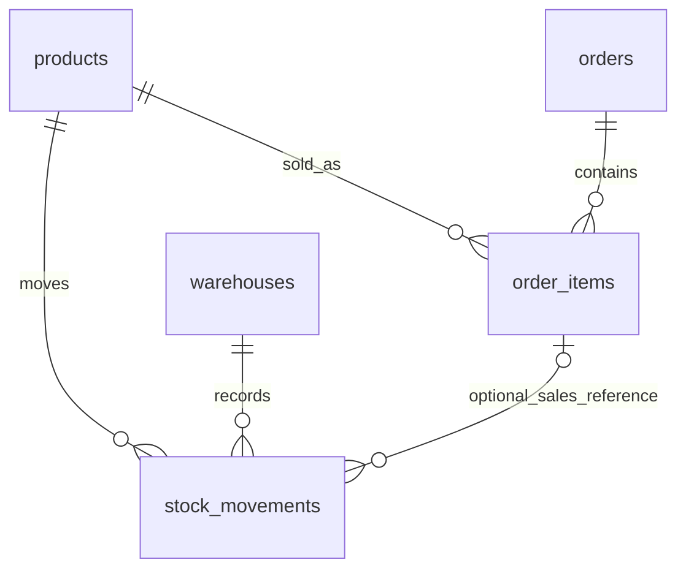

# เดโม 0.2 — ข้อมูลขายและคลังสินค้า 5 ตาราง

> **อัปเดต:** API รุ่น 0.3 เพิ่มฝั่ง LLM และการเปรียบเทียบแล้ว อ่าน [SPRINT2.md](SPRINT2.md)
> โครงสร้างข้อมูลห้าตารางและคำถาม Rule-based ที่อธิบายด้านล่างยังเหมือนเดิม

## เริ่มใช้งาน

```powershell
.\start-demo.ps1
```

เปิด `http://127.0.0.1:8000/docs` → `POST /query` → `Try it out` แล้วลอง:

```json
{"text": "สินค้าคงเหลือแยกตามคลังมีเท่าไหร่"}
```

```json
{"text": "เดือนกันยายน 2569 มีสินค้าจ่ายออกแต่ละชนิดกี่หน่วย"}
```

คำถามขายเดิมยังใช้ได้ เช่น `ยอดขายเดือนกันยายน 2569` และ
`สินค้าขายดีที่สุด 3 อันดับ เดือนกันยายน 2569`

## ที่มาและขอบเขตการอ้างอิง

AI agent ช่วยสร้าง schema, ข้อมูลสังเคราะห์, กฎ, reference SQL และ tests
โครงสร้างฉบับนี้ขยายให้มีเหตุการณ์รับ–จ่ายและสถานที่เก็บ เพื่อทดลอง Text-to-SQL
บนแบบจำลองงานคลังขนาดเล็ก ยังไม่ได้ตรวจสอบกับ WMS ขององค์กรหรือระบบอ้างอิงภายนอก
จึงไม่อ้างว่าครอบคลุม WMS จริงหรือแทนทุกระบบได้
การผ่าน tests ยืนยันเฉพาะกรณีที่ตรวจ ไม่ใช่หลักฐานความถูกต้องทุกประโยคภาษาไทย

## หนึ่งแถวหมายถึงอะไร

| ตาราง | ความหมายหนึ่งแถว | คอลัมน์สำคัญ |
|---|---|---|
| products | สินค้าหนึ่งรายการ | id, name, price (ราคาปัจจุบัน) |
| orders | ออเดอร์หนึ่งรายการ | id, order_date, status |
| order_items | รายการสินค้าหนึ่งบรรทัดในออเดอร์ | id, order_id, product_id, qty, unit_price (ราคาขณะขาย) |
| warehouses | คลังหนึ่งแห่ง | id, name |
| stock_movements | เหตุการณ์สินค้าหนึ่งชนิดที่คลังหนึ่งแห่ง | id, product_id, warehouse_id, movement_date, movement_type, qty, order_item_id (ไม่บังคับ) |



เหตุการณ์สต็อกอาจอ้างถึงรายการขาย แต่ไม่จำเป็น เช่น เบิกใช้ภายในไม่มีรายการขาย
หากอ้างถึงรายการขาย ต้องเป็นประเภท issue และต้องเป็นสินค้ารหัสเดียวกับรายการขายนั้น
หนึ่งรายการขายมีหลายเหตุการณ์จ่ายได้ เพื่อแสดงการจ่ายบางส่วน/หลายครั้ง

## กติกาสามอย่างที่ต้องแยกให้ออก

### 1. ยอดขาย

`SUM(order_items.qty * order_items.unit_price)` เฉพาะออเดอร์ status = paid
ช่วงเวลาอิง `orders.order_date` ไม่ใช่วันชำระเงินจริง เพราะไม่มี paid_at
คำว่า "ขายดี" ในเดโมจัดอันดับตามยอดเงิน ใช้ id สินค้าตัดสินเมื่อยอดเท่ากัน

### 2. สินค้าคงเหลือ

`opening + receipt - issue` แยกตามสินค้าและคลัง

- opening = จำนวนตั้งต้น ณ จุดเริ่มเก็บประวัติ
- receipt = จำนวนรับเข้าหลังจากนั้น
- issue = จำนวนจ่ายออก
- qty เก็บเป็นจำนวนเต็มบวกเสมอ ประเภทเป็นตัวกำหนดบวกหรือลบ
- ใช้ทุกเหตุการณ์ที่บันทึกไว้ รวมรายการเดือนตุลาคมด้วย ไม่ใช่คงเหลือเฉพาะกันยายน
- คู่สินค้า/คลังที่ไม่มี movement แสดง 0 ผ่าน CROSS JOIN + LEFT JOIN
- เป็นยอดตามบัญชีการเคลื่อนไหว ไม่ใช่ผลตรวจนับสินค้าจริง
- สมมติว่าข้อมูลเป็นเหตุการณ์ที่เกิดขึ้นแล้ว บันทึกครบตั้งแต่ opening และไม่ใช่รายการนัดหมายอนาคต
- ยังไม่รองรับคงเหลือ ณ วันย้อนหลังหรือกรองเฉพาะชื่อสินค้า/คลัง

### 3. ยอดจ่ายออกในเดือน

`SUM(stock_movements.qty)` เฉพาะ movement_type = issue
ช่วงเวลาอิง `stock_movements.movement_date` รวมทุกคลัง แยกสินค้า
ไม่มี issue ในเดือนนั้นแสดง 0
ไม่กรอง paid: การชำระเงินและการจ่ายของเป็นคนละเหตุการณ์
ไม่เรียกว่า "จำนวนสินค้าขาย" เพราะมีทั้งการจ่ายเพื่อขายและจ่ายเพื่อวัตถุประสงค์อื่น
ยังไม่รองรับแยกยอดจ่ายออกตามคลัง หากถามจะปฏิเสธ ไม่ละข้อความแล้วคืนผลรวมแทน

## ข้อมูลตั้งต้นที่คำนวณตรวจเองได้

ฐานตั้งต้น: สินค้า 5, ออเดอร์ 10, รายการขาย 19, คลัง 2, movements 29
ไม่มีการแก้ข้อมูลขายในการ upgrade inventory; หากข้อมูลขายเดิมถูกเปลี่ยนมาก่อน
จำนวน/ผลอาจต่างจากค่าฐานนี้ ให้ใช้ reset เมื่อประสงค์กลับสู่ชุดสาธิตตั้งต้น

### คงเหลือจากทุกรายการที่บันทึก

| สินค้า | คลังหลัก | คลังสำรอง |
|---|---:|---:|
| ปากกา | 131 | 35 |
| สมุด | 68 | 18 |
| ดินสอ | 65 | 30 |
| แฟ้ม | 33 | 7 |
| ยางลบ | 81 | 0 |

ตัวอย่าง: ปากกาในคลังหลัก = `100 ตั้งต้น + 50 รับเข้า - (10+4+5) จ่ายออก = 131`
แฟ้มในคลังหลัก = `30 ตั้งต้น + 10 รับเข้า - 6 จ่ายกันยายน - 1 จ่ายตุลาคม = 33`
ยางลบคลังสำรองไม่มี movements จึงเป็น 0 ไม่หายจากผลลัพธ์

### จ่ายออกกันยายน 2569 (รวมทุกคลัง)

| สินค้า | จำนวนจ่ายออก |
|---|---:|
| ปากกา | 22 |
| สมุด | 12 |
| ดินสอ | 15 |
| แฟ้ม | 9 |
| ยางลบ | 19 |

- ปากกา: จ่ายตามรายการขาย 19 + จ่ายที่ไม่อ้างรายการขาย 3 = 22
- แฟ้ม: จ่ายตามออเดอร์ paid 6 + จ่ายบางส่วนจากออเดอร์ pending 3 = 9
- จ่ายวันที่ 31 สิงหาคมและ 1 ตุลาคมไม่รวมในกันยายน
- ยอดขายกันยายนยังเป็น **1250.00 บาท** ตามนิยามเดิม
- สินค้าแต่ละชนิดใช้หน่วยประจำสินค้าในตัวอย่าง ไม่ได้จำลองการแปลงหน่วยหรือจำนวนทศนิยม

## Constraint ที่ฐานข้อมูลตรวจจริง

- Primary key ไม่ซ้ำ; Foreign key สินค้า/คลังต้องมีอยู่
- qty > 0 และ movement_type อยู่ใน opening/receipt/issue
- opening มีได้หนึ่งแถวต่อคู่สินค้าและคลัง
- order_item_id เป็น NULL ได้ แต่ถ้ามี ต้องเป็น issue
- Composite foreign key `(order_item_id, product_id)` ป้องกันอ้างรายการขายคนละสินค้า

## สิ่งที่ยังไม่ได้บังคับ/รองรับ

- ไม่ตรวจว่า issue รวมเกินจำนวนที่สั่งหรือไม่
- ไม่ป้องกันยอดติดลบหรือการแข่งขันตัดสต็อกหลายรายการพร้อมกัน
- ไม่ตรวจลำดับวันที่ระหว่าง opening, order และ dispatch
- ไม่ทำระบบโอนคลัง จองสินค้า คืนสินค้า lot/expiry หรือหน่วยบรรจุ
- ไม่มี audit trail ของการแก้/ลบ movement; ในการสาธิตให้ถือเป็นประวัติที่ลงรายการครบแล้ว
- ไม่สร้าง issue อัตโนมัติเมื่อ orders เป็น paid และไม่ยกเลิก movement ตามสถานะออเดอร์
- รายงาน inventory จำกัดผลสูงสุด 200 แถว; ชุดสาธิตใช้ 10 คู่สินค้า/คลังจึงแสดงครบ
- เส้นทาง `/query` ยังเป็น Rule-based; เส้นทาง LLM และ `/compare` ดูคู่มือ Sprint 2

`scripts.local_demo add-sale` เปลี่ยนเฉพาะยอดขาย ไม่เปลี่ยนสต็อก เพราะไม่ได้สร้างเหตุการณ์จ่าย
นี่เป็นพฤติกรรมที่ตั้งใจแยกไว้ ไม่ควรอธิบายว่า paid แล้ว stock ลดเอง

## แก้โค้ดอะไรและทำไม

| ไฟล์ | หน้าที่ |
|---|---|
| db/demo_schema.sql | โครงสร้างห้าตารางและ constraints |
| db/demo_inventory_seed.sql | opening/receipt/issue ที่คำนวณตรวจเองได้ |
| config/inventory.yaml | คำพ้อง คำประกอบ และคำอธิบายนิยาม inventory |
| app/nlp/inventory.py | จับสองรูปแบบคำถาม inventory ตรวจเดือนและข้อความตกค้าง |
| app/sql/inventory.py | สร้าง SELECT คงเหลือและยอดจ่ายออก |
| app/nlp/demo.py | เลือกเส้นทาง sales/inventory และ execute แบบ read-only |
| scripts/local_demo.py | backup/upgrade โดยรักษาข้อมูลขาย และ reset ชุดห้าตาราง |
| db/demo_inventory_reference.sql | SQL อ้างอิงคนละรูปแบบกับตัวสร้าง query |
| tests/test_inventory.py | ตรวจคำตอบเต็ม การเปลี่ยนข้อมูล และ constraint กับ PostgreSQL |
| eval/run_inventory.py | บันทึกผลตรวจการพัฒนา 6 คำถาม + ปฏิเสธ 4 ข้อแยกกัน |

กฎ inventory ใช้ substring/regex และตรวจข้อความที่ยังไม่เข้าใจ ไม่ใช่โมเดล NER
business_definition ที่ API ส่งเป็นข้อความจาก config; query builder ต้องสอดคล้องกัน
SQL ยอดขายยังใช้เส้นทางเดิม ส่วน inventory ใช้รูปแบบ query ที่กำหนดไว้ชัดเจน
การ JOIN ตารางการขายกับ movements โดยไม่ระวังอาจทำยอดซ้ำ จึงคำนวณแยกตาม grain

## ตรวจและทำซ้ำ

```powershell
.\.venv\Scripts\python.exe -m pytest tests -q
.\.venv\Scripts\python.exe eval/run_day1.py
.\.venv\Scripts\python.exe eval/run_inventory.py
```

Tests ใช้ disposable schemas ใน `seminar_tests` ไม่แก้ข้อมูลเดโม
รายงานการพัฒนาอยู่ `output/day1-report.json` และ `output/inventory-report.json`
เป็น development checks ไม่ใช่ held-out benchmark หรือผลสรุปว่าใช้กับ WMS จริงได้

หากต้องกลับสู่ข้อมูลตั้งต้น (ล้างและสร้างข้อมูลสังเคราะห์ทั้งห้าตารางใหม่):

```powershell
.\.venv\Scripts\python.exe -m scripts.local_demo reset
```

การ upgrade ใช้ `python -m scripts.local_demo upgrade-inventory` โดยสำรองก่อนใน
`.local/backups/before-inventory-*.sql` และไม่แทนที่ข้อมูลขายเดิม
backup นี้มีข้อมูลภายในเดโม ไม่ควรนำข้อมูลจริงหรือ credentials ไปเก็บใน Git

## สคริปต์อธิบายให้อาจารย์ฟัง

“เราเพิ่ม warehouses เพื่อระบุสถานที่เก็บ และ stock_movements เพื่อเก็บเหตุการณ์รับ–จ่าย
คงเหลือคำนวณจากยอดตั้งต้นบวกรับเข้าลบจ่ายออก แยกจากการชำระเงินของออเดอร์
ตัวอย่างแฟ้มจากออเดอร์ pending จ่ายออกไปแล้วสามหน่วย จึงลดสต็อกแต่ยังไม่เป็นยอดขาย
ตามนิยาม paid ของเดโม เราตรวจผลกับตารางคำนวณและ reference SQL บนชุดสังเคราะห์
ส่วนความสอดคล้องกับ WMS จริงยังต้องตรวจสอบกับระบบอ้างอิงเพิ่มเติมครับ”
