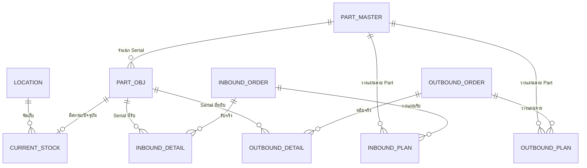

# WMS MVP Data Dictionary

**Version:** 1.0-draft

**Updated:** 2026-11-12

**Canonical DDL:** `db/wms_mvp_schema.sql`

**Review status:** ตรวจเทียบ DDL และ Seed แล้ว; รอ Independent review ด้านความหมายธุรกิจ

เอกสารนี้อธิบาย Schema 10 ตารางสำหรับการทดลอง Thai Text-to-SQL ด้าน Warehouse Operations ข้อมูลที่ใช้ประเมินเป็นข้อมูลสังเคราะห์ ไม่ใช่ข้อมูลจากระบบจริง

## Source of Truth

เรียงลำดับเมื่อข้อมูลขัดกัน:

1. โครงสร้างและ Constraint: `db/wms_mvp_schema.sql`
2. ความหมายการคำนวณ: `WMS_BUSINESS_RULES.md`
3. ข้อมูลทดสอบ: `db/wms_mvp_seed.sql`
4. Scope: `SCOPE_WMS_MVP.md`

Schema นี้ดัดแปลงจาก `Succeed_BDMS/ALL_SQL.sql` Branch `develop` โดยตัดตารางและ FK ของ Phase 2 รวมถึง Trigger ฝั่งเขียนออก

## ภาพรวมความสัมพันธ์

## Grain ของแต่ละตาราง

| ตาราง | หนึ่งแถวแทนอะไร |
|---|---|
| `part_master` | ชนิดสินค้า/อะไหล่หนึ่ง Part |
| `part_obj` | สินค้าจริงหนึ่งชิ้นที่มี Serial Number |
| `location` | ตำแหน่งจัดเก็บหนึ่งจุด |
| `current_stock` | สถานะปัจจุบันของ Serial หนึ่งชิ้นที่ยังอยู่ในขอบเขตสต็อก |
| `inbound_order` | งานรับเข้าหนึ่งรายการ |
| `inbound_plan` | จำนวนที่วางแผนรับของหนึ่ง Part ในหนึ่ง Inbound Order |
| `inbound_detail` | Serial หนึ่งชิ้นที่บันทึกรับจริงใน Inbound Order |
| `outbound_order` | งานจ่ายออกหนึ่งรายการ |
| `outbound_plan` | จำนวนที่วางแผนจ่ายของหนึ่ง Part ในหนึ่ง Outbound Order |
| `outbound_detail` | Serial หนึ่งชิ้นที่บันทึกว่าหยิบจริงใน Outbound Order |

## `part_master`

| คอลัมน์ | ชนิด | Null | Key / Constraint | ความหมาย |
|---|---|---:|---|---|
| `part_id` | `VARCHAR` | ไม่ได้ | PK | รหัสชนิดสินค้า/อะไหล่ |
| `part_name` | `VARCHAR` | ไม่ได้ | — | ชื่อ Part |
| `uom` | `VARCHAR` | ไม่ได้ | — | หน่วยนับ เช่น ชิ้น หรือชุด |
| `weight_kg` | `NUMERIC(12,3)` | ได้ | ต้องไม่ติดลบ | น้ำหนักต่อหน่วยเป็นกิโลกรัม; `NULL` หมายถึงยังไม่ทราบ |
| `created_at` | `TIMESTAMPTZ` | ไม่ได้ | Default `now()` | เวลาสร้างข้อมูล |
| `updated_at` | `TIMESTAMPTZ` | ไม่ได้ | Default `now()` | เวลาที่ผู้เขียนข้อมูลระบุว่าแก้ล่าสุด |

## `part_obj`

| คอลัมน์ | ชนิด | Null | Key / Constraint | ความหมาย |
|---|---|---:|---|---|
| `serial_no` | `VARCHAR` | ไม่ได้ | PK | Serial Number ที่ระบุสินค้าหนึ่งชิ้น |
| `part_id` | `VARCHAR` | ไม่ได้ | FK → `part_master.part_id` | ชนิดของ Serial นี้ |
| `created_at` | `TIMESTAMPTZ` | ไม่ได้ | Default `now()` | เวลาสร้างข้อมูล Serial |
| `updated_at` | `TIMESTAMPTZ` | ไม่ได้ | Default `now()` | เวลาแก้ข้อมูล Serial ล่าสุด |

การมีแถวใน `part_obj` ไม่ได้แปลว่ายังมีของพร้อมใช้ ต้องตรวจ `current_stock` และสถานะด้วย

## `location`

| คอลัมน์ | ชนิด | Null | Key / Constraint | ความหมาย |
|---|---|---:|---|---|
| `location_id` | `VARCHAR` | ไม่ได้ | PK | รหัสตำแหน่งจัดเก็บ |
| `zone_type` | `VARCHAR` | ไม่ได้ | — | ประเภทพื้นที่ เช่น Receiving, Storage, Quarantine |
| `pick_sequence` | `INTEGER` | ได้ | ถ้ามีต้องมากกว่า 0 | ลำดับแนะนำในการหยิบ |
| `max_capacity` | `INTEGER` | ได้ | ถ้ามีต้องมากกว่า 0 | ความจุสูงสุด; MVP ยังไม่กำหนดวิธีเทียบต่าง UOM |
| `created_at` | `TIMESTAMPTZ` | ไม่ได้ | Default `now()` | เวลาสร้างตำแหน่ง |
| `updated_at` | `TIMESTAMPTZ` | ไม่ได้ | Default `now()` | เวลาแก้ข้อมูลล่าสุด |

## `current_stock`

| คอลัมน์ | ชนิด | Null | Key / Constraint | ความหมาย |
|---|---|---:|---|---|
| `serial_no` | `VARCHAR` | ไม่ได้ | PK, FK → `part_obj.serial_no` | Serial ที่มีสถานะสต็อกปัจจุบัน |
| `condition` | `VARCHAR` | ไม่ได้ | `Good`, `Damaged` | สภาพกายภาพของสินค้า |
| `location_id` | `VARCHAR` | ได้ | FK → `location.location_id` | ตำแหน่งปัจจุบัน; อาจ `NULL` เมื่อไม่อยู่ใน Location เช่น In Transit |
| `status` | `VARCHAR` | ไม่ได้ | `Receiving`, `Available`, `In Transit`, `Quarantine` | สถานะทางปฏิบัติการปัจจุบัน |
| `created_at` | `TIMESTAMPTZ` | ไม่ได้ | Default `now()` | เวลาที่เริ่มมีแถวสต็อกนี้ |
| `updated_at` | `TIMESTAMPTZ` | ไม่ได้ | Default `now()` | เวลาปรับสถานะ/ตำแหน่งล่าสุด |

`current_stock` เป็น Snapshot ไม่ใช่ Movement ledger จึงใช้ตอบสต็อกปัจจุบัน แต่พิสูจน์สต็อกย้อนหลังไม่ได้

## `inbound_order`

| คอลัมน์ | ชนิด | Null | Key / Constraint | ความหมาย |
|---|---|---:|---|---|
| `inbound_id` | `VARCHAR` | ไม่ได้ | PK | รหัสงานรับเข้า |
| `invoice_no` | `VARCHAR` | ได้ | — | เลขเอกสารภายนอกในบริบทเดโม |
| `arrival_date` | `DATE` | ได้ | — | วันที่มาถึงที่ใช้เป็นฐานเวลาของคำถาม Inbound |
| `status` | `VARCHAR` | ไม่ได้ | `Draft Plan`, `Received`, `Completed`, `Cancelled` | สถานะงานรับเข้าแบบ Exact value |
| `container_no` | `VARCHAR` | ได้ | — | หมายเลขตู้/หน่วยขนส่ง ถ้ามี |
| `created_at` | `TIMESTAMPTZ` | ไม่ได้ | Default `now()` | เวลาสร้าง Order |
| `updated_at` | `TIMESTAMPTZ` | ไม่ได้ | Default `now()` | เวลาแก้ Order ล่าสุด |

ความต่างเชิงกระบวนการระหว่าง `Received` และ `Completed` ยังต้องให้เจ้าของระบบยืนยัน ในการประเมินรุ่นแรกจึงกรองตามข้อความสถานะตรงตัว ไม่อนุมานว่าสถานะใดรวมอีกสถานะหนึ่ง

## `inbound_plan`

| คอลัมน์ | ชนิด | Null | Key / Constraint | ความหมาย |
|---|---|---:|---|---|
| `plan_id` | `UUID` | ไม่ได้ | PK, Default UUID | รหัสแถวแผนรับ |
| `inbound_id` | `VARCHAR` | ไม่ได้ | FK → `inbound_order.inbound_id` | งานรับเข้าที่แผนสังกัด |
| `part_id` | `VARCHAR` | ไม่ได้ | FK → `part_master.part_id` | Part ที่วางแผนรับ |
| `expected_qty` | `INTEGER` | ไม่ได้ | `> 0` | จำนวนที่วางแผนรับ |
| `created_at` | `TIMESTAMPTZ` | ไม่ได้ | Default `now()` | เวลาสร้างแผน |
| `updated_at` | `TIMESTAMPTZ` | ไม่ได้ | Default `now()` | เวลาแก้แผนล่าสุด |

คู่ `(inbound_id, part_id)` ไม่ซ้ำ จึงมีแผนเดียวต่อ Part ในหนึ่ง Inbound Order

## `inbound_detail`

| คอลัมน์ | ชนิด | Null | Key / Constraint | ความหมาย |
|---|---|---:|---|---|
| `in_detail_id` | `UUID` | ไม่ได้ | PK, Default UUID | รหัสรายการรับจริง |
| `inbound_id` | `VARCHAR` | ไม่ได้ | FK → `inbound_order.inbound_id` | งานรับเข้าที่บันทึกรับ Serial |
| `serial_no` | `VARCHAR` | ไม่ได้ | FK → `part_obj.serial_no` | Serial ที่รับจริง |
| `condition` | `VARCHAR` | ไม่ได้ | `Good`, `Damaged` | สภาพที่ตรวจพบตอนรับ |
| `damage_image_url` | `TEXT` | ได้ | — | ตำแหน่งหลักฐานความเสียหาย; Seed ใช้ URI สังเคราะห์ |
| `time_received_by` | `TIMESTAMPTZ` | ได้ | — | เวลาที่บันทึกรับจริง ชื่อเดิมลงท้าย `by` แต่ชนิดเป็นเวลา |
| `created_at` | `TIMESTAMPTZ` | ไม่ได้ | Default `now()` | เวลาสร้างแถว |
| `updated_at` | `TIMESTAMPTZ` | ไม่ได้ | Default `now()` | เวลาแก้แถวล่าสุด |

คู่ `(inbound_id, serial_no)` ไม่ซ้ำ แต่ Serial เดียวอาจปรากฏคนละ Inbound Order ได้ตาม Constraint ปัจจุบัน ประเด็นนี้ต้องทบทวนหากระบบจริงห้ามรับ Serial ซ้ำตลอดอายุข้อมูล

## `outbound_order`

| คอลัมน์ | ชนิด | Null | Key / Constraint | ความหมาย |
|---|---|---:|---|---|
| `outbound_id` | `VARCHAR` | ไม่ได้ | PK | รหัสงานจ่ายออก |
| `order_date` | `DATE` | ไม่ได้ | — | วันที่ Order และฐานเวลาของคำถาม Outbound |
| `outstatus` | `VARCHAR` | ไม่ได้ | `Pending`, `Picked` | สถานะ Phase 1 แบบ Exact value |
| `created_at` | `TIMESTAMPTZ` | ไม่ได้ | Default `now()` | เวลาสร้าง Order |
| `updated_at` | `TIMESTAMPTZ` | ไม่ได้ | Default `now()` | เวลาแก้ Order ล่าสุด |

สถานะ `Shipped` และ `Delivered` รวมถึง POD อยู่ Phase 2 จึงไม่อยู่ใน DDL นี้

## `outbound_plan`

| คอลัมน์ | ชนิด | Null | Key / Constraint | ความหมาย |
|---|---|---:|---|---|
| `plan_id` | `UUID` | ไม่ได้ | PK, Default UUID | รหัสแถวแผนจ่าย |
| `outbound_id` | `VARCHAR` | ไม่ได้ | FK → `outbound_order.outbound_id` | งานจ่ายออกที่แผนสังกัด |
| `part_id` | `VARCHAR` | ไม่ได้ | FK → `part_master.part_id` | Part ที่วางแผนจ่าย |
| `expected_qty` | `INTEGER` | ไม่ได้ | `> 0` | จำนวนที่วางแผนจ่าย |
| `created_at` | `TIMESTAMPTZ` | ไม่ได้ | Default `now()` | เวลาสร้างแผน |
| `updated_at` | `TIMESTAMPTZ` | ไม่ได้ | Default `now()` | เวลาแก้แผนล่าสุด |

คู่ `(outbound_id, part_id)` ไม่ซ้ำ

## `outbound_detail`

| คอลัมน์ | ชนิด | Null | Key / Constraint | ความหมาย |
|---|---|---:|---|---|
| `out_detail_id` | `UUID` | ไม่ได้ | PK, Default UUID | รหัสรายการหยิบจริง |
| `outbound_id` | `VARCHAR` | ไม่ได้ | FK → `outbound_order.outbound_id` | งานจ่ายออกที่ Serial ถูกหยิบ |
| `serial_no` | `VARCHAR` | ไม่ได้ | FK → `part_obj.serial_no` | Serial ที่หยิบจริง |
| `time_picked_by` | `TIMESTAMPTZ` | ได้ | — | เวลาที่บันทึกการหยิบ ชื่อเดิมลงท้าย `by` แต่ชนิดเป็นเวลา |
| `created_at` | `TIMESTAMPTZ` | ไม่ได้ | Default `now()` | เวลาสร้างแถว |
| `updated_at` | `TIMESTAMPTZ` | ไม่ได้ | Default `now()` | เวลาแก้แถวล่าสุด |

คู่ `(outbound_id, serial_no)` ไม่ซ้ำ แต่ Constraint ยังไม่ห้าม Serial เดียวถูกบันทึกในหลาย Outbound Order

## ตารางและคอลัมน์ที่ตัดออกใน Phase 1

| ต้นทางเดิม | สิ่งที่ตัดออก | เหตุผล |
|---|---|---|
| `inbound_order` | `provider_id` | `logistics_provider` อยู่ Phase 2 |
| `inbound_detail` | `inspector_user_id` | `app_user` และ User analytics อยู่ Phase 2 |
| `outbound_order` | `customer_id`, `shipment_id`, POD fields | Customer/Shipment/POD อยู่ Phase 2 |
| `outbound_detail` | `picker_user_id` | User analytics อยู่ Phase 2 |
| Trigger functions | การสร้าง ID/อัปเดตสต็อกอัตโนมัติ | งานทดลองเป็น Read-only และ Seed ต้องกำหนดผลซ้ำได้ |

## Baseline Seed Snapshot

Seed รุ่นแรกมี Part 4 ชนิด, Serial 6 ชิ้น, Location 4 จุด, Inbound Order 3 รายการ และ Outbound Order 2 รายการ โดยตั้งใจครอบคลุม:

- Available, Receiving, In Transit และ Quarantine
- Good และ Damaged
- งานรับเสร็จ งานร่าง และงานยกเลิก
- แผนที่ครบ แผนที่รับบางส่วน และแผนที่ยังไม่รับ
- Outbound ที่หยิบแล้วและยัง Pending
- Serial ที่ `location_id` เป็น `NULL` ระหว่าง In Transit

ค่าพวกนี้เป็น Fixture สำหรับทดสอบ ไม่ใช่สัดส่วนหรือพฤติกรรมของคลังจริง

## Known Limitations

- ไม่มี Movement history จึงตอบสต็อกย้อนหลังไม่ได้
- ไม่มีจำนวนแบบ Non-serial; หนึ่งแถว `current_stock` เท่ากับหนึ่ง Serial
- ไม่มี Trigger ใน DDL ทดลอง ผู้เขียนข้อมูลต้องรักษา `updated_at` และความสอดคล้องของสถานะเอง
- `max_capacity` ยังไม่ผูกกับ UOM และไม่ถูกบังคับเมื่อเพิ่ม Stock
- Lifecycle ของ Inbound โดยเฉพาะ `Received` กับ `Completed` ยังรอการยืนยัน
- ยังไม่ห้าม Serial เดียวถูกอ้างในหลาย Order ตลอดอายุข้อมูล
